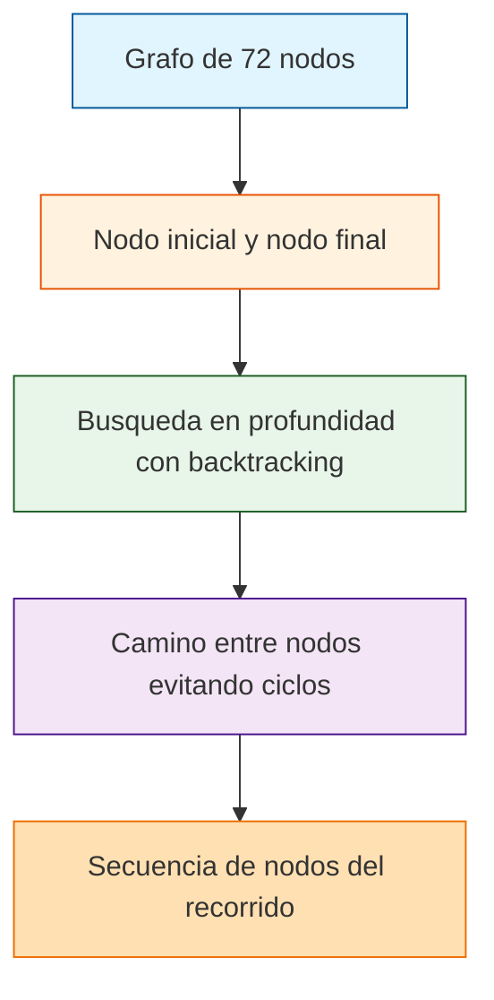

# Laberinto de 72 Estados

<p align="center">
  <a href="https://github.com/Matthew-Garay/72estados/actions/workflows/ci.yml"></a>
  <a href="https://github.com/Matthew-Garay/72estados/security/dependabot"></a>
</p>

Implementacion de busqueda en profundidad (DFS) sobre un grafo de 72 nodos representado como lista de adyacencia en Prolog. Dados un nodo inicial y uno final, el programa devuelve la secuencia de nodos que forman el camino entre ambos, evitando ciclos.

## Stack tecnologico

- **Lenguaje:** SWI-Prolog
- **Paradigma:** Programacion logica, busqueda en grafos, backtracking
- **Entorno:** SWI-Prolog 8.x

## Arquitectura



## Caracteristicas

- Representacion de grafos como lista de adyacencia
- Busqueda en profundidad (DFS) con backtracking
- Evitacion de ciclos en el recorrido
- Codigo modular y documentado

## Como ejecutar

### Requisitos previos

- SWI-Prolog 8.x instalado

### Ejecucion

1. Clona el repositorio:
   ```bash
   git clone https://github.com/Matthew-Garay/72estados.git
   cd 72estados
   ```
2. Ejecuta el archivo principal con SWI-Prolog:
   ```bash
   swipl -s laberinto72estados.pl -g "main" -t "halt"
   ```
3. El programa muestra el camino encontrado entre los nodos especificados.

## Estructura del proyecto

```
72estados/
├── laberinto72estados.pl    # Codigo fuente en Prolog
├── .gitignore               # Archivos excluidos del control de versiones
├── LICENSE                  # Licencia MIT
├── README.md                # Este archivo
└── docs/                    # Documentacion extendida
    ├── setup-guide.md       # Guia de instalacion
    └── architecture.md      # Diagrama de arquitectura
```

## Contacto

<p align="center">
  <a href="mailto:1911.garay.perez@gmail.com"></a>
  <a href="https://www.linkedin.com/in/matthewgarayperez/"></a>
</p>
